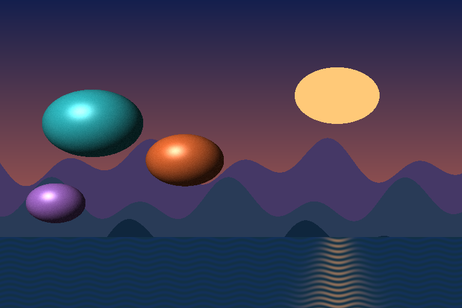
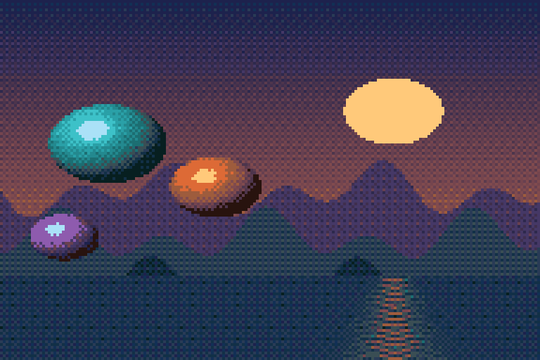

# PixelC3

A Blender add-on for turning image textures into pixel art. Set the pixel grid, choose colors and dithering, then export a PNG or apply the result to a material. Processing runs locally using Blender's bundled NumPy.

| Procedural source | PixelC3 result |
| --- | --- |
|  |  |

## Install

Requires Blender 4.2 or newer. Use the extension ZIP from the project's releases or build it from the checkout with `python3 tools/build.py` (Python 3.11+).

1. In Blender, open **Edit → Preferences → Get Extensions**.
2. Open the menu at the top right, choose **Install from Disk**, and select `pixelc3-0.4.3-extension.zip`. Local builds are in `dist/`.
3. Enable PixelC3. In an **Image Editor** or **3D View**, press **N** and open the **PixelC3** tab.

The build also produces a `-legacy.zip` for the legacy Add-ons installer. Use a single install method. Install the updated extension ZIP over an existing extension to upgrade.

## Use

1. **Open Image**, select an image in the source card, or **Use Current** from the Image Editor / active material.
2. In **Look → Pixel Grid**, set the **Short Edge** count or enable **Independent X / Y**. Choose **Crisp / Nearest** or **Smooth / Bilinear** sampling. The computed grid size appears beneath the controls.
3. In **Look → Color**, choose **Source Colors**, **Build Palette**, **Channel Levels**, or **Palette / LUT**. Choose the palette size or reference profile. **Palette Tuning** holds refinement, starting colors, color space, dark detail and forced extrema.
4. In **Look → Dither**, choose a pattern and amount. Pattern Mixing and Where to Dither reveal blend controls, custom inputs and masks when needed. **Floyd–Steinberg** uses serpentine error diffusion; set Diffusion to 1 for full strength. It requires channel or palette quantization and excludes custom Hald LUTs. **Source & Variation** holds input encoding and the random seed.
5. **Generate Texture** processes into a separate packed image, with progress and Cancel. The button reads **Generate Palette** or **Generate LUT** when making those assets. **Source**, **Result**, and **Compare** switch the Image Editor display. **Auto** updates when controls change; image painting still needs Generate.
6. Open **Styles** to load or save a look, import/export JSON, or **Reset This Look**. The small reset icons in Pixel Grid, Color and Dither reset only that group.
7. Open **Export** to choose resolution and **Save PNG**, **Use in Active Material**, or open **Batch Export**. Preview Smoothing and Palette & LUT Tools are separate expandable sections. PNG export excludes smoothing and mask preview and saves without the scene's AgX/Filmic transform. Applying to a material is undoable and requires a ready texture with previews disabled.

**Output Size** can retain the source dimensions as enlarged pixel blocks or produce the actual low-resolution texture. The source-resolution option uses nearest sampling for clean output. Bilinear and N64 three-point filtering are preview options.

Switching sources restores each source's last result, processing controls, input
encoding, and custom pattern/mask/palette/LUT image selections. This survives
renaming images and saving/reopening the .blend. A new source inherits the current
style once, then remembers its own edits. Switching marks the restored result as
needing Generate, so source pixel edits are included. Auto Update remains a scene
preference. Reset and preset loading affect the selected source's controls.

If the sidebar shows **Source Missing**, use **Relink Source** to locate the
original file. Relinking keeps the selected image, its saved look and its
existing result. **Export Packed Result** saves the last generated PNG stored
in the project, even when the source is missing or the look has since changed.

### Batch export

In **Export → Batch Export**, use **Current**, **All Sources**, or **Load Files…**
(multiple selection). All Sources excludes generated results and unsupported image
types. Duplicate images are excluded; uncheck entries to skip them or select a
row and use the minus button to remove it.

Choose the style with the main processing controls (or load a saved preset), then
click **Export Checked Images** and choose an output folder. The current style is used
for every checked image; per-image saved styles, source selection, results and
materials are retained. Preview filtering and mask preview are disabled, just as
with single PNG export. Palette/LUT output options remain active. Each file is
named `<source>_pixelc3.png`; existing files get a numbered suffix instead of
being replaced. Invalid images are reported and the rest of the queue continues.

Processing runs one image at a time in the background with overall progress.
**Cancel** stops the current worker and the remaining queue; completed PNGs stay
on disk. **View Report** lists exports and errors; **Open Output Folder** opens
the chosen destination. Changing processing settings cancels an active batch.

**Styles → Reset This Look** resets processing controls while retaining source/output
images, custom input images, and saved presets. The small reset icons in
Pixel Grid, Color and Dither reset only that section. The current
result remains visible until Generate is used (or Auto updates it).

Open **Styles** to save a named processing style in Blender's user preset
directory and load it in any project. **Export Settings JSON** and **Import
Settings JSON** transfer styles between machines. Presets contain controls only,
not source images, outputs or custom image assets; those input selections are
retained when a preset is loaded. Imports are validated completely before any
settings change. A repeated display name creates another saved preset.

## Palettes and LUTs

Fourteen built-in profiles include digital Amiga/GBC/Master System/Web RGB grids,
Munafo's Apple II NTSC values, IIgs Mega II RGB, Stella Atari NTSC/SECAM,
Colodore C64 PAL with two VIC-II revisions, and NESdev's 2C03 RGB DAC table.
The original Game Boy green profile is explicitly marked **Stylized**, with an
additional digital grayscale option. Profile names and tooltips specify which
digital values or display models they represent. See the
[palette references](docs/PALETTE_REFERENCES.md) for numerical provenance and
the limits of each model.

**Custom Palette Image** accepts up to 256 distinct visible 8-bit RGB colors. Use a swatch image without gradients or antialiasing. Generated palettes can be output as a 16 × 16 swatch image, with unused entries filled using the first color.

**Custom Hald LUT** uses red-fastest RGB indexing with top-down image rows. Supported square sizes include 64, 512, and 4096. **Output Palette to Hald LUT** and **Output Default Hald LUT** produce 4096 × 4096 images (Hald level 16, cube side 256). The LUT output option takes precedence over palette swatch output.

## Image handling and limits

- File and Generated images, up to 16,777,216 pixels, are supported. Bake UDIMs, sequences, movie frames, and render results to ordinary image files first.
- Processing uses straight RGBA and sRGB values. The adapter flips Blender's bottom-up buffers, unpremultiplies premultiplied sources, and recognizes sRGB, Linear Rec.709, Raw, and Non-Color. Other OCIO spaces require prior conversion or an explicit Input Encoding override. HDR values are clipped to the 0–1 texture range.
- Outputs are 8-bit RGBA. Bilinear sampling uses premultiplied alpha to avoid dark/colored fringes. Fully transparent pixels do not participate in palette training.
- Generated palette training samples at most 12,288 visible pixels, deterministically seeded, and uses bounded distance matrices. The requested color count is an upper bound when there are fewer distinct colors.
- Large LUTs and perceptual searches through full hardware RGB grids can take time. Generate provides progress and cancellation; custom presets and source switches cancel obsolete jobs. The numerical worker never imports Blender's API. Inputs are snapshotted on the main thread, and a finished result is committed on the main thread. Manual Generate is required for LUT output; automatic LUT regeneration is disabled. Exporting a ready palette/LUT reuses the generated pixels.
- Floyd–Steinberg processes pixels sequentially. Large grids, especially with perceptual searches through the 32,768-color GBC profile, take longer; choose a smaller pixel grid or RGB application space for faster processing. PNG transfer/saving is on the main thread between batch workers.
- Identical requests use a content-addressed result cache capped at 128 MiB. Pixel changes and control changes invalidate the key. Source reads, hashing, and the final image transfer/packing still run on Blender's main thread, so very large inputs can briefly pause at those stages.
- This processes image textures. It does not bake procedural materials, install compositor effects, or render sprite sheets.

## Development and license

`pixel4ever/` contains the Blender extension and NumPy engine. The standalone
processing tests and Blender integration checks are under `tests/`. See
[Contributing](CONTRIBUTING.md) for build, test and demo instructions, and
the [changelog](CHANGELOG.md) for version history.

PixelC3 is distributed under [GPL-3.0-or-later](LICENSE). See
[NOTICE](NOTICE) for third-party palette credits and acknowledgments.
